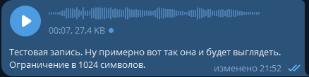

# TGVoiceMessagesEditText

Фоновое консольное приложение для Windows, которое добавляет текстовую расшифровку к вашим голосовым сообщениям в Telegram. Оно входит в Telegram под вашим аккаунтом, ждёт отправленное вами голосовое сообщение, локально распознаёт речь через Whisper и записывает текст в подпись сообщения.



Распознанный текст появляется под голосовым сообщением, поэтому собеседник может прочитать его, не прослушивая запись.

## Как это работает

1. Входит в Telegram как пользователь (MTProto, через [WTelegramClient](https://github.com/wiz0u/WTelegramClient)).
2. Получает обновления о новых сообщениях и выбирает голосовые.
3. Сразу ставит в подпись `Processing…`, чтобы было видно, что сообщение в работе.
4. Скачивает аудио и декодирует Ogg/Opus в PCM 16 кГц ([Concentus](https://github.com/lostromb/concentus)).
5. Распознаёт речь на вашем компьютере через [Whisper.net](https://github.com/sandrohanea/whisper.net) с моделью `ggml-large-v3-turbo`. Аудио не покидает компьютер.
6. Заменяет подпись `Processing…` на расшифровку. Если распознать ничего не удалось или произошла ошибка, подпись убирается.

### Какие сообщения обрабатываются

- Голосовые в личных чатах и в «Избранном».
- Только отправленные вами.
- Не пересланные и без существующей подписи.
- Не старше `MaxMessageAgeHours` (по умолчанию 24 часа).
- Не отправленные ботам.

### Длина подписи

Telegram ограничивает подпись 1024 символами, для Premium-аккаунтов — 2048. Лимит определяется при входе. Более длинная расшифровка обрезается и заканчивается символом `…`.

## Требования

- Windows x64.
- .NET 9 SDK для сборки из исходников. Опубликованный exe самодостаточный.
- `api_id` и `api_hash` Telegram с [my.telegram.org](https://my.telegram.org) → API development tools.
- Около 1,6 ГБ на диске под модель Whisper, она скачивается при первом запуске.
- Опционально: видеокарта. Vulkan работает на большинстве GPU, CUDA 12 — на NVIDIA.

## Сборка

```powershell
.\src\TGVoiceMessagesEditText\build-single-exe.ps1 -OutputDir "D:\dist\TGVoiceMessagesEditText"
```

Скрипт публикует самодостаточный однофайловый exe и копирует его в `OutputDir`. Параметр `-Launch` запускает приложение после сборки.

При повторном развёртывании `OutputDir` очищается, кроме `settings.json`, `data`, `models` и `cuda`, поэтому вход в аккаунт, настройки и скачанные файлы сохраняются.

Запуск тестов:

```powershell
dotnet test
```

## Первый запуск

1. Запустите `TGVoiceMessagesEditText.exe`.
2. Введите `api_id` и `api_hash`. Они сохранятся в `settings.json`.
3. Введите номер телефона, код подтверждения и, если включён, пароль двухэтапной аутентификации.
4. Дождитесь загрузки модели. Прогресс выводится в консоль.

После этого приложение продолжает работать и подписывает новые голосовые сообщения. Остановить его можно через `Ctrl+C`.

Приложение переносимое: все файлы лежат рядом с exe.

| Путь | Назначение |
| --- | --- |
| `settings.json` | Настройки |
| `data/` | Сессия Telegram и состояние обновлений |
| `models/` | Модель Whisper |
| `cuda/` | Библиотеки CUDA, скачиваются при использовании бэкенда CUDA |
| `test-recordings/` | Сохранённые голосовые, только в тестовом режиме |

Если папка доступна только для чтения, сессия Telegram хранится в памяти и входить придётся при каждом запуске.

## Настройки

`settings.json` создаётся рядом с exe.

| Ключ | По умолчанию | Описание |
| --- | --- | --- |
| `Telegram.ApiId` | `0` | Telegram API id |
| `Telegram.ApiHash` | пусто | Telegram API hash |
| `Telegram.PhoneNumber` | пусто | Номер телефона в международном формате. Если пусто, запрашивается интерактивно |
| `Telegram.MaxMessageAgeHours` | `24` | Сообщения старше этого срока игнорируются |
| `Speech.Backend` | `Vulkan` | `Vulkan`, `Cuda` или `Cpu` |
| `Speech.GpuName` | `GTX 1660` | Название предпочитаемой видеокарты. Если она не найдена, используется CPU |
| `Speech.CpuThreads` | `0` | Число потоков CPU. `0` — все ядра |
| `Speech.Language` | `ru` | Код языка распознавания |
| `Speech.ModelPath` | пусто | Путь к своей модели ggml. Если пусто, используется `models/ggml-large-v3-turbo.bin` |
| `TestMode` | `false` | Сохраняет каждое обработанное голосовое как `.ogg` и `.wav` в `test-recordings/` |

Укажите в `Speech.GpuName` свою видеокарту: значение по умолчанию — карта автора.

## Примечания

- Приложение работает от имени пользовательского аккаунта, а не бота. Храните `settings.json` и `data/` в тайне: они дают доступ к вашему аккаунту Telegram.
- Качество распознавания зависит от выбранного языка. Укажите в `Speech.Language` язык, на котором говорите.
